<p align="center">
  
</p>

<h1 align="center">Poké League</h1>

<p align="center">
  <b>Practice Kubernetes security by earning all eight Kanto badges.</b><br>
  Every gym is a real security control. Every workload is a Pokémon. Team Rocket is trying to get into prod.
</p>

<p align="center">
  <a href="https://github.com/vincenzodavinci/poke-league/actions/workflows/league.yml"></a>
  
  
  
  
  
</p>

<p align="center">
  
  
  
  
  
  
  
  
</p>

<p align="center">
  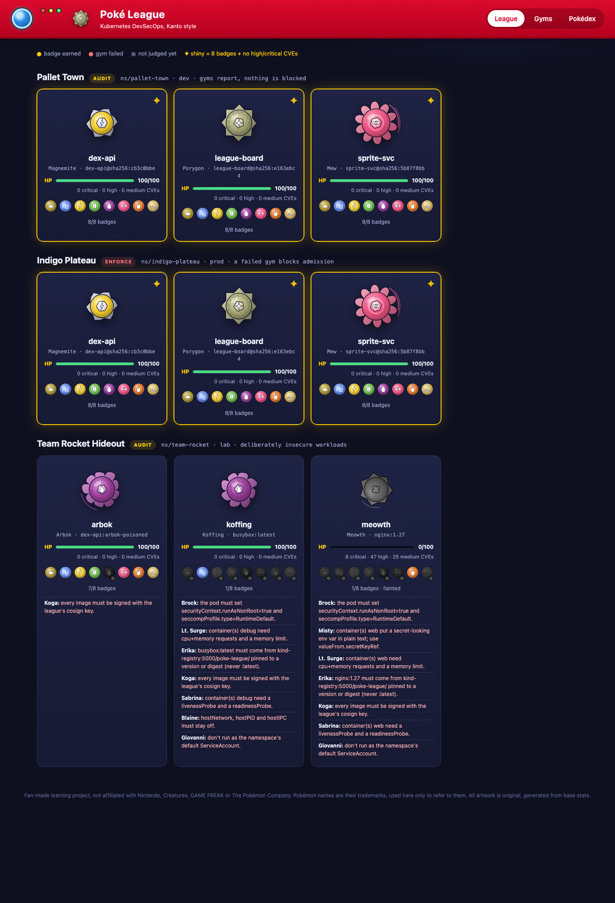
</p>

## Why I built this


**This project exists because of my love for Pokémon FireRed.**

FireRed was the game I couldn't put down: picking a starter in Pallet Town, grinding through Viridian Forest, and
finally walking into the Indigo Plateau with a team I'd built badge by badge. Every gym leader taught one lesson, and
you couldn't skip ahead until you'd learned it.

As I continued refining my security practice, the parallel was hard to miss: good security posture is built gate by gate (hardening, secrets management, supply-chain integrity, least privilege), and each gate is best learned by facing it head-on. So I built a league that makes every one of those gates something you have to earn.

If you grew up with a Game Boy Advance and you're learning cloud security now, this one's for you. Gotta secure 'em all.

## What this is

A complete, runnable DevSecOps platform on a local [kind](https://kind.sigs.k8s.io/) cluster, themed as the Kanto Pokémon League:

| Pokémon world | Real thing |
|---|---|
| **8 Gym Leaders** | 8 [Kyverno](https://kyverno.io) admission policies written in CEL. Pass one, earn its badge. |
| **Pallet Town** | `pallet-town` namespace (dev). Gyms **audit**: failures show up as warnings and on the board. |
| **Indigo Plateau** | `indigo-plateau` namespace (prod). Gyms **enforce**: fail one and you're not admitted. |
| **The Elite Four + Champion** | The CI pipeline: secret scanning, SAST, SCA + SBOM, signing + provenance, then an end-to-end DAST run. |
| **HP** | Live CVE counts from the [Trivy Operator](https://github.com/aquasecurity/trivy-operator). Too many and your Pokémon faints. |
| **Shiny ✦** | 8/8 badges **and** no high or critical CVEs. |
| **Team Rocket** | Deliberately insecure workloads in a `team-rocket` lab namespace: a CTF to attack, then fix. |
| **The League Board** | A Pokédex-styled dashboard that reads Kyverno PolicyReports and Trivy VulnerabilityReports straight from the cluster. |

The app being secured is real too: three small Go services (a FireRed-accurate Kanto Pokédex API, a sprite server and the board), built on distroless images, hardened, signed and pinned by digest.

## Getting started, step by step

**You'll need:** a Mac, Linux, or Windows with WSL2 · about **4 GB of free RAM** for Docker · ~15 minutes the first time.
Everything runs on your own machine; nothing is deployed to the cloud.

> New to Kubernetes? Keep the [**Beginner cheat sheet**](#beginner-cheat-sheet--answers) open in another tab. It
> explains every term and command used below.

### Step 1: Install the tools

**Mac** (with [Homebrew](https://brew.sh)):
```bash
brew install git kind kubectl helm python
brew install --cask docker-desktop   # Docker Desktop. Prefer something lighter? brew install colima docker
```

**Linux:** install [Docker Engine](https://docs.docker.com/engine/install/), then
[kind](https://kind.sigs.k8s.io/docs/user/quick-start/#installation),
[kubectl](https://kubernetes.io/docs/tasks/tools/) and [Helm](https://helm.sh/docs/intro/install/), plus `git`,
`make` and `python3` from your package manager.

**Windows:** install [WSL2](https://learn.microsoft.com/windows/wsl/install) and
[Docker Desktop](https://docs.docker.com/desktop/setup/install/windows-install/) with WSL integration on, then do
everything from the **Ubuntu** terminal using the Linux instructions.

✅ **Check:** each of these prints a version number:
```bash
docker --version && kind --version && kubectl version --client && helm version --short && python3 --version
```

### Step 2: Start Docker

- **Docker Desktop:** open the app and wait until it says *Engine running*.
- **Colima:** `colima start --cpu 4 --memory 8`

✅ **Check:** `docker info` prints details without an error.

### Step 3: Get the code

```bash
git clone https://github.com/vincenzodavinci/poke-league.git
cd poke-league
```

✅ **Check:** your terminal prompt now ends in `poke-league`. Run every command below from this folder.

### Step 4: Build the league

```bash
make demo
```

This takes **3–5 minutes**. It creates a local cluster, installs Kyverno, builds and signs the images, opens the
gyms, deploys the app and releases Team Rocket.

✅ **Check:** near the end you see `16/16 gyms open`, several `successfully rolled out` lines, and finally
`League Board: http://localhost:8088`. If something fails, jump to [Troubleshooting](#troubleshooting).

### Step 5: Open the League Board

Go to **http://localhost:8088**, or run `make board`.

✅ **Check:** six shiny ✦ cards under *Pallet Town* and *Indigo Plateau*, and three failing *Team Rocket* cards. Click
the **Gyms** and **Pokédex** tabs.

### Step 6 (optional): Turn on vulnerability scanning

```bash
make trivy
```

✅ **Check:** after ~5 minutes the HP bars fill in. Meowth drops to **0 HP and faints**, thanks to 8 critical CVEs.

### Step 7: Play

1. `make challenge`: try to sneak Team Rocket into prod, and read why every gym says no.
2. **[Team Rocket labs](docs/team-rocket.md)**: attack Meowth, Koffing and Arbok, then fix them.
3. **[The gyms](docs/gyms.md)**: break each rule on purpose and watch its badge go dark.
4. Stuck? Every answer is in the [cheat sheet below](#answers).

### Step 8: Clean up

```bash
make down              # deletes the cluster; `make demo` rebuilds it any time
colima stop            # only if you use Colima
```

### Troubleshooting

| What you see | Fix |
|---|---|
| `make: command not found` (Mac) | `xcode-select --install` |
| `Cannot connect to the Docker daemon` | Docker isn't running: redo [Step 2](#step-2-start-docker) |
| kind fails with `could not find a log line…` or `Too many open files` | Raise the inotify limit, then `make down && make demo`. Colima: `colima ssh -- sudo sysctl -w fs.inotify.max_user_instances=1024 fs.inotify.max_user_watches=1048576`. Linux: the same `sudo sysctl …` without `colima ssh --` |
| The board doesn't load at `localhost:8088` | Another program is using that port (`lsof -nP -iTCP:8088` shows which). Run `make board-dev` and open **http://localhost:8081** instead |
| HP shows `??` | Scanning isn't on: run `make trivy` and wait a few minutes |
| Badges show *not judged yet* | Wait 1–2 minutes; Kyverno writes its reports in the background |
| `python3: command not found` | Install Python 3 (Step 1) |

Every `kubectl`/`helm` command in the Makefile is pinned to the `kind-kanto` context, so it can never touch another
cluster on your machine.

## The gyms

| | Gym | Policy | What it teaches |
|:-:|---|---|---|
|   | **Brock** · Boulder | `brock-hardened-pods` | Pod hardening: non-root, seccomp, no privilege escalation, read-only root FS, drop all capabilities |
|  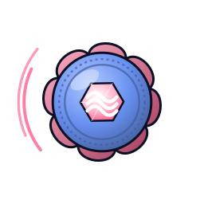 | **Misty** · Cascade | `misty-no-plaintext-secrets` | Secrets belong in `Secret` refs, never as literals in Git |
|  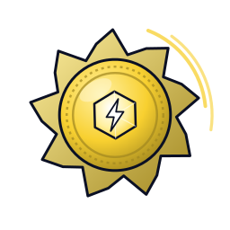 | **Lt. Surge** · Thunder | `surge-resource-limits` | Requests and limits: scheduling, and stopping noisy-neighbour DoS |
|  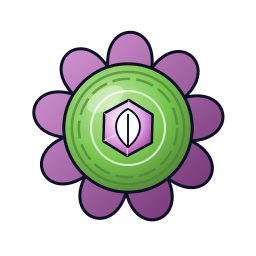 | **Erika** · Rainbow | `erika-trusted-images` | Trusted registries, pinned versions, why `:latest` is not a version |
|  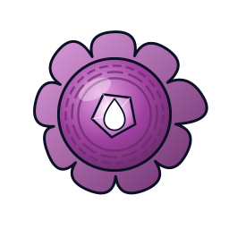 | **Koga** · Soul | `koga-signed-images` | Supply-chain integrity: only cosign-signed images run |
|  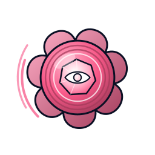 | **Sabrina** · Marsh | `sabrina-health-probes` | Liveness/readiness probes and self-healing |
|  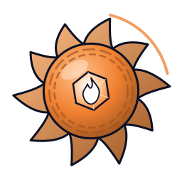 | **Blaine** · Volcano | `blaine-no-host-access` | Container escape routes: privileged, host namespaces, hostPath |
|   | **Giovanni** · Earth | `giovanni-least-privilege` | Workload identity: own ServiceAccount, API tokens only on opt-in, least-privilege RBAC |

Each one is explained, with a hands-on exercise, in **[docs/gyms.md](docs/gyms.md)**.

<p align="center">
  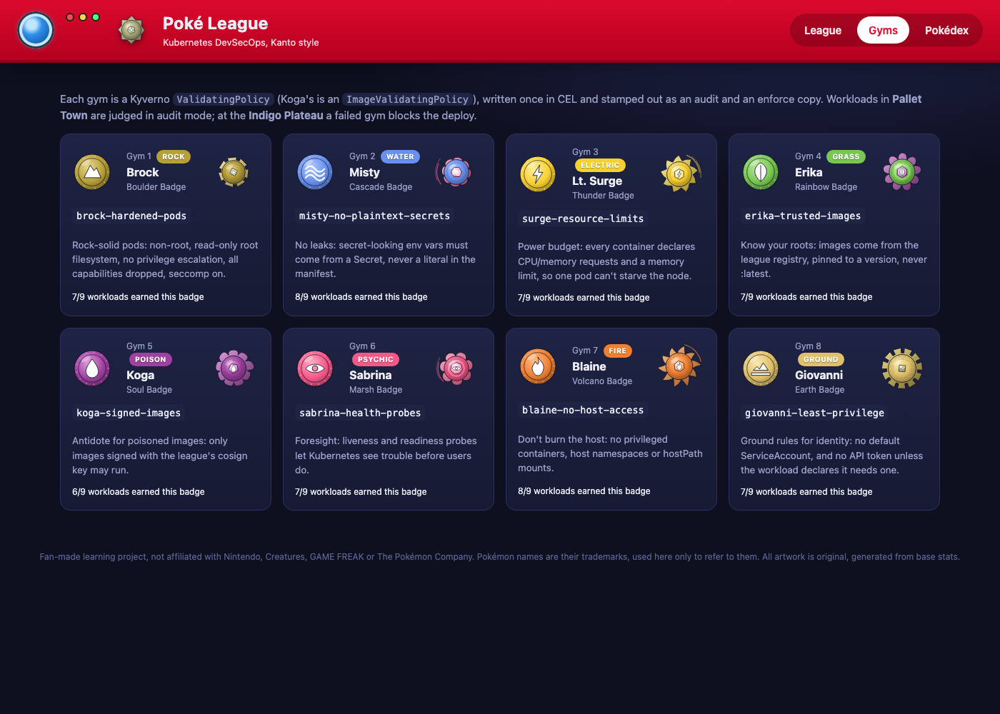
</p>

## Team Rocket's hideout

<p>
  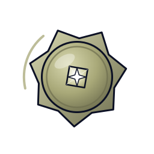
  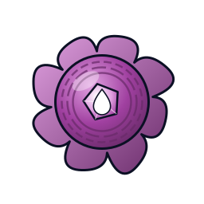
  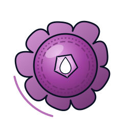
</p>

Three workloads that fail on purpose, each a pattern you'll meet in real clusters:

- **Meowth** · the copy-pasted Deployment: root, a public image with 8 critical CVEs, a plaintext password, the default ServiceAccount with its token mounted. *1/8 badges, fainted.*
- **Koffing** · the forgotten debug pod: privileged, `hostPID`, the node's root filesystem at `/host`. *1/8.*
- **Arbok** · the poisoned image: a flawless manifest, but an image nobody signed. Seven gyms wave it through; only Koga catches it. *7/8.*

Steal the token, escape to the node, then fix each one until it's shiny: **[docs/team-rocket.md](docs/team-rocket.md)**.

## The Elite Four (CI)

[`.github/workflows/league.yml`](.github/workflows/league.yml) runs on every push and pull request:

| | Stage | Tools |
|---|---|---|
| 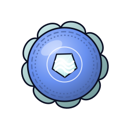 | **Lorelei** · secrets | gitleaks, over the full Git history |
| 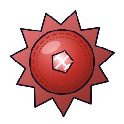 | **Bruno** · SAST | Semgrep (Go, Dockerfile, Kubernetes, Actions rules), govulncheck |
| 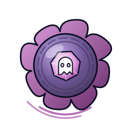 | **Agatha** · dependencies | Trivy (vulns, misconfig, secrets), SPDX SBOM |
| 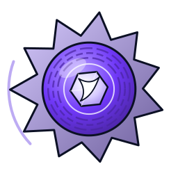 | **Lance** · supply chain | Buildx, keyless cosign signing (OIDC → Fulcio → Rekor), signed SBOM attestation, SLSA provenance |
|  | **Champion** · end-to-end | `make demo` on a fresh kind cluster, assert 8/8 badges, assert Team Rocket is denied in prod, OWASP ZAP DAST scan |

Every third-party action is pinned to a commit SHA, permissions are least-privilege per job, and Dependabot keeps Go modules, base-image digests and actions current. Details: **[docs/elite-four.md](docs/elite-four.md)**.

## The Pokédex

The app the league protects: all 151 Kanto Pokémon with **Gen 3 (FireRed) typings**, so Clefairy is Normal and Magnemite is Electric/Steel, plus base stats, heights and weights.

<p align="center">
  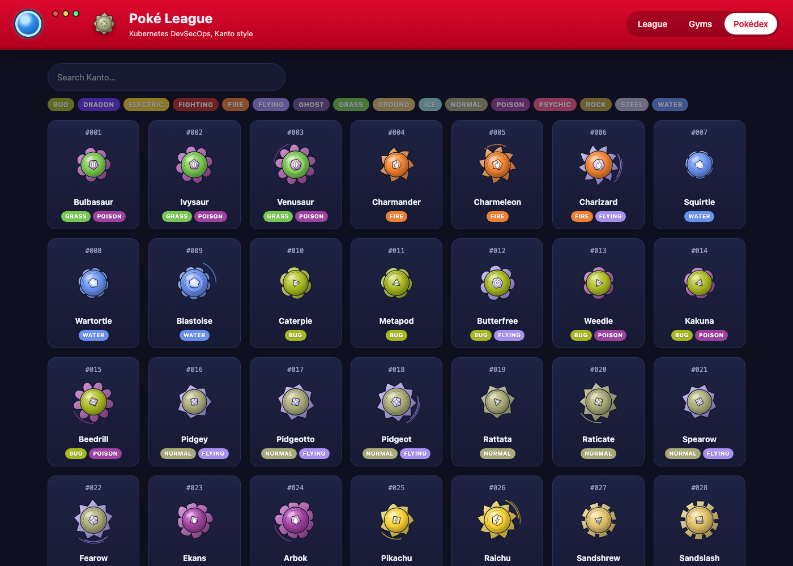
</p>

## The art: Dex Crests

Every Pokémon is shown as an original **Dex Crest**, generated by [`scripts/make_crests.py`](scripts/make_crests.py)
from its real Gen 3 data, so no official artwork is used:

| Data | Becomes |
|---|---|
| Primary type | the silhouette (flame tips for Fire, waves for Water, crenellations for Rock…) and the core glyph |
| Secondary type | the rim color |
| HP · Attack · Defense | size · number and reach of points · armor rings |
| Sp. Atk · Sp. Def · Speed | facets on the core gem · a halo · motion arcs |

<p>
  
  
  
  
  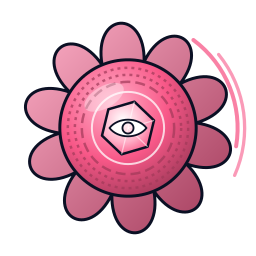
  
</p>

Charizard is fire-orange with flame tips and speed arcs; Snorlax is huge (all that HP); Magikarp, with base Attack 10,
is small and humble. The gym badges are original sigils too.

## How it fits together

```
 browser ──► league-board (NodePort) ──► dex-api      Kanto dex JSON (embedded)
               │      │                └► sprite-svc   crests and gym sigils (embedded)
               │      └─ reads ─► PolicyReports (Kyverno) + VulnerabilityReports (Trivy)
               │
  kubectl apply ─► Kyverno admission ─► 8 gyms × {audit: pallet-town, team-rocket | enforce: indigo-plateau}
                                         Koga verifies cosign signatures against kind-registry:5000
```

Architecture, design decisions and the field notes from building it (the bugs worth learning from) are in **[docs/architecture.md](docs/architecture.md)**.

## Learning path

1. `make demo`, open the board, and look around.
2. Read a gym in [docs/gyms.md](docs/gyms.md), then break it on purpose in Pallet Town and watch the badge go dark.
3. Run `make challenge` to see enforcement in prod.
4. Work through the [Team Rocket labs](docs/team-rocket.md): attack first, then fix.
5. `make trivy` and watch CVEs become HP damage. Patch Meowth's image and revive it.
6. Push to GitHub and watch the Elite Four run ([docs/elite-four.md](docs/elite-four.md)).
7. Write a ninth gym. Ideas: require NetworkPolicies, ban `NodePort` in prod, require the SBOM attestation that Lance already produces.

## Beginner cheat sheet & answers

An optional reference. Use it if you get stuck, or skip it if you'd rather figure things out. The answers are hidden:
**click a line to reveal it.** Try first!

### Words you'll see

| Term | In plain English |
|---|---|
| **Kubernetes / cluster** | Software that runs and manages containers. Here, the whole cluster lives on your laptop |
| **kind** | "Kubernetes in Docker": a full cluster running inside a Docker container |
| **Namespace** | A folder inside the cluster. Here, one per town: `pallet-town`, `indigo-plateau`, `team-rocket` |
| **Pod / Deployment** | A pod is a running container. A Deployment keeps the right number of pods running |
| **Manifest** | The YAML file describing what to run (`deploy/rocket/meowth.yaml`, for example) |
| **Kyverno policy** | A rule checked whenever something is created. Each gym is one |
| **Audit vs enforce** | Audit warns but allows it (dev). Enforce blocks it (prod) |
| **Secret** | A Kubernetes object for passwords and keys, so they stay out of manifests and Git |
| **ServiceAccount / token** | A pod's identity for talking to Kubernetes. Its token is a password the pod carries |
| **RBAC** | Who is allowed to do what. A token is only as dangerous as its RBAC |
| **Image / tag / digest** | An image is the packaged app. A tag (`:1.27`) can move; a digest (`@sha256:…`) never changes |
| **cosign signature** | Cryptographic proof of who built an image. Koga only admits signed ones |
| **CVE** | A publicly known vulnerability. Trivy counts them, and they cost HP |

### Commands you'll use

```bash
alias k='kubectl --context kind-kanto'   # a shortcut; run it again in every new terminal window
k get pods -n team-rocket                # what's running in a namespace
k describe pod <name> -n team-rocket     # details and events (why isn't it starting?)
k logs deploy/meowth -n team-rocket      # the app's output
k exec -it deploy/meowth -n team-rocket -- sh   # open a shell inside the container
k apply -f my-file.yaml --dry-run=server # ask the gyms for a verdict without changing anything
k apply -f my-file.yaml                  # deploy or update for real
make reports                             # every gym result, straight from Kyverno
make help                                # every make target
```

### Reading the board

- **Lit badge** = passed that gym · **dark badge with a red dot** = failed · **faded** = not judged yet.
- **The red list on a card** is each gym leader telling you exactly what to fix.
- **HP** = 100 minus damage from CVEs (critical −25, high −8, medium −2). At 0 HP the card **faints**.
- **Shiny ✦** = all 8 badges **and** no high or critical CVEs.

### Answers

<details>
<summary><b>Meowth 1</b>: read the leaked password</summary>

```bash
k -n team-rocket get deploy meowth -o jsonpath='{.spec.template.spec.containers[0].env}'
```
It's `pikachu-is-mine-123`, in plain text. Anyone who can read Deployments (or the Git repo) sees it.
</details>

<details>
<summary><b>Meowth 2</b>: steal its API token, then make it dangerous</summary>

```bash
k -n team-rocket exec deploy/meowth -- sh -c 'curl -sk -H "Authorization: Bearer $(cat /var/run/secrets/kubernetes.io/serviceaccount/token)" https://kubernetes.default.svc/api/v1/namespaces/team-rocket/secrets'
```
That returns `Forbidden`: the default ServiceAccount has no permissions yet. Now play the careless teammate:
```bash
k -n team-rocket create secret generic giovannis-vault --from-literal=master-ball-code=150-mewtwo
k -n team-rocket create rolebinding just-make-it-work --clusterrole=edit --serviceaccount=team-rocket:default
```
Run the same `curl` again, with `/giovannis-vault` added to the end of the URL: the secret comes back (base64-encoded).
Clean up with `k -n team-rocket delete rolebinding just-make-it-work` and `k -n team-rocket delete secret giovannis-vault`.
</details>

<details>
<summary><b>Meowth 3</b>: the full fix, step by step (8/8 and shiny ✦)</summary>

**a. Move the password into a Secret** (Misty):
```bash
k -n team-rocket create secret generic meowth-db --from-literal=password=pikachu-is-mine-123
```

**b. Use a non-root nginx image from the league registry, and sign it** (Brock, Erika, Koga). The stock `nginx` image
runs as root, so switch to `nginxinc/nginx-unprivileged`. Use its newest `-alpine` tag: old base images are full of
CVEs. When this was written, that was `1.30.6-alpine`.
```bash
docker pull nginxinc/nginx-unprivileged:1.30.6-alpine
docker tag nginxinc/nginx-unprivileged:1.30.6-alpine localhost:5001/poke-league/meowth:1.30.6
docker push localhost:5001/poke-league/meowth:1.30.6

# Ask the REGISTRY for the digest. Docker's own `docker inspect` can report a different
# (upstream) digest after a push, and signing that one doesn't count.
DIGEST=$(curl -sI -H 'Accept: application/vnd.oci.image.index.v1+json, application/vnd.docker.distribution.manifest.list.v2+json, application/vnd.oci.image.manifest.v1+json, application/vnd.docker.distribution.manifest.v2+json' \
  http://localhost:5001/v2/poke-league/meowth/manifests/1.30.6 | grep -i docker-content-digest | awk '{print $2}' | tr -d '\r')
echo $DIGEST

# Sign it with the league key (the same command `make sign` uses):
docker run --rm --network kind --user $(id -u):$(id -g) -v $PWD/.cosign:/keys -w /keys -e COSIGN_PASSWORD= \
  ghcr.io/sigstore/cosign/cosign:v2.6.1 sign --yes --key /keys/cosign.key \
  --allow-insecure-registry --allow-http-registry --tlog-upload=false kind-registry:5000/poke-league/meowth@$DIGEST
```

**c. The fixed manifest.** Replace `<DIGEST>` with the value printed above. The comments say which gym each part
satisfies:
```yaml
apiVersion: v1
kind: ServiceAccount
metadata:
  name: meowth
  namespace: team-rocket
automountServiceAccountToken: false           # Giovanni: no token
---
apiVersion: apps/v1
kind: Deployment
metadata:
  name: meowth
  namespace: team-rocket
  labels: {app.kubernetes.io/name: meowth}
spec:
  replicas: 1
  selector:
    matchLabels: {app.kubernetes.io/name: meowth}
  template:
    metadata:
      labels: {app.kubernetes.io/name: meowth}
      annotations:
        poke-league.dev/pokemon: "52"
    spec:
      serviceAccountName: meowth              # Giovanni: its own ServiceAccount
      automountServiceAccountToken: false
      securityContext:                        # Brock
        runAsNonRoot: true
        runAsUser: 101
        runAsGroup: 101
        seccompProfile: {type: RuntimeDefault}
      containers:
        - name: web
          image: kind-registry:5000/poke-league/meowth@<DIGEST>   # Erika (league registry, digest) + Koga (signed)
          env:
            - name: DB_PASSWORD
              valueFrom:
                secretKeyRef: {name: meowth-db, key: password}  # Misty
          ports:
            - containerPort: 8080             # the unprivileged image listens on 8080
          securityContext:                    # Brock
            allowPrivilegeEscalation: false
            readOnlyRootFilesystem: true
            capabilities: {drop: ["ALL"]}
          resources:                          # Lt. Surge
            requests: {cpu: 10m, memory: 32Mi}
            limits: {memory: 128Mi}
          livenessProbe:                      # Sabrina
            httpGet: {path: /, port: 8080}
          readinessProbe:
            httpGet: {path: /, port: 8080}
          volumeMounts:
            - {name: tmp, mountPath: /tmp}    # nginx needs one writable dir; the rest stays read-only
      volumes:
        - {name: tmp, emptyDir: {}}
```

**d. Check, then apply:**
```bash
k apply -f meowth-fixed.yaml --dry-run=server   # no warnings means every gym passes
k apply -f meowth-fixed.yaml
```
Within a minute Meowth shows **8/8**, and once Trivy has rescanned, **shiny ✦** with 100 HP. To reset the lab:
`k apply -f deploy/rocket/meowth.yaml`.
</details>

<details>
<summary><b>Koffing 1</b>: take over the node</summary>

```bash
k -n team-rocket exec -it deploy/koffing -- chroot /host sh
ls /etc/kubernetes/          # admin.conf and super-admin.conf: cluster-admin credentials
exit
```
A privileged pod with the host filesystem mounted *is* the node.
</details>

<details>
<summary><b>Koffing 2</b>: fix it</summary>

Delete it (`k -n team-rocket delete deploy koffing`). For real node debugging, use the temporary, built-in tool, then
remove the pod it creates:
```bash
k debug node/kanto-control-plane -it --image=busybox:1.36 -- chroot /host sh
# when you're done: find the debug pod it created, and delete it
k get pods -n default
k delete pod node-debugger-kanto-control-plane-xxxxx -n default   # use the name from the line above
```
To bring the lab back: `k apply -f deploy/rocket/koffing.yaml`.
</details>

<details>
<summary><b>Arbok 1</b>: why is a perfect manifest blocked?</summary>

Its image was rebuilt by someone without the signing key, so it has no valid signature. See for yourself:
```bash
docker run --rm --network kind -v $PWD/.cosign:/keys ghcr.io/sigstore/cosign/cosign:v2.6.1 verify --key /keys/cosign.pub \
  --allow-insecure-registry --allow-http-registry --insecure-ignore-tlog kind-registry:5000/poke-league/dex-api:dev            # ✅ verified
docker run --rm --network kind -v $PWD/.cosign:/keys ghcr.io/sigstore/cosign/cosign:v2.6.1 verify --key /keys/cosign.pub \
  --allow-insecure-registry --allow-http-registry --insecure-ignore-tlog kind-registry:5000/poke-league/dex-api:arbok-poisoned # ❌ no signatures found
```
</details>

<details>
<summary><b>Arbok 2</b>: fix it (and why you might not want to)</summary>

Get the registry digest the same way as in *Meowth 3b* (with `manifests/arbok-poisoned`), sign it with the same
`cosign sign` command, then restart Arbok so the gyms judge it again:
```bash
k -n team-rocket rollout restart deploy/arbok
```
It earns 8/8. (Kyverno caches signature checks for a few minutes, so if Koga still says "unsigned", wait and restart
it again. That cache is another reason real deployments pin images by digest.) The real lesson is the question: **should** you have signed an image you didn't build? A signature
proves who built something, not that it's safe. In real pipelines only CI holds the signing identity.
</details>

<details>
<summary><b>Gym exercises</b>: what each gym wants (quick reference)</summary>

| Gym | Add or change in the manifest |
|---|---|
| Brock 🪨 | Pod: `runAsNonRoot: true`, `seccompProfile: {type: RuntimeDefault}`. Container: `allowPrivilegeEscalation: false`, `readOnlyRootFilesystem: true`, `capabilities: {drop: ["ALL"]}` |
| Misty 💧 | Secret-looking env vars use `valueFrom.secretKeyRef`, never `value:` |
| Lt. Surge ⚡ | `resources.requests.cpu`, `resources.requests.memory`, `resources.limits.memory` |
| Erika 🌿 | An image from `kind-registry:5000/poke-league/` with a tag or digest, never `:latest` |
| Koga 💜 | The image is signed with the league's cosign key |
| Sabrina 👁️ | Both a `livenessProbe` and a `readinessProbe` |
| Blaine 🔥 | No `privileged`, `hostNetwork`, `hostPID`, `hostIPC` or `hostPath` |
| Giovanni ⛰️ | Its own ServiceAccount (not `default`), plus `automountServiceAccountToken: false` unless it needs the API |
</details>

## Repository layout

```
assets/            original art: 151 Dex Crests, 8 gym sigils, favicon · embedded into sprite-svc
data/              FireRed-accurate Kanto dex · embedded into dex-api
cmd/               dex-api, sprite-svc, league-board
internal/          httpx (secure headers, timeouts, graceful shutdown), dex, sprites, board
web/               the League Board UI: plain JS under a strict CSP, no build step
build/Dockerfile   one multi-stage, digest-pinned, distroless Dockerfile for every service
deploy/kind/       the "kanto" cluster + local registry
deploy/k8s/        namespaces + PSA, RBAC, hardened Deployments, NetworkPolicies, dev/prod overlays
deploy/policies/   the 8 gyms (CEL), audit/enforce overlays, Kyverno CLI tests
deploy/rocket/     Team Rocket's lab workloads
scripts/           fetch_assets.py (dex facts), make_crests.py (the art), render_policies.py (cosign key → Koga)
.github/           the Elite Four pipeline, Dependabot
```

## Credits and legal

A non-commercial, fan-made learning project, **not affiliated with or endorsed by** Nintendo, Creatures Inc., GAME FREAK
inc. or The Pokémon Company. Pokémon, character, place and badge names are their trademarks, used here only to refer
to them. **No official artwork, sprites or game text are included.** Every image is original, generated by
`scripts/make_crests.py`. Dex facts (names, types, stats) come from [PokeAPI](https://pokeapi.co).

Everything here, including the original art, is MIT licensed. See [LICENSE](LICENSE).
